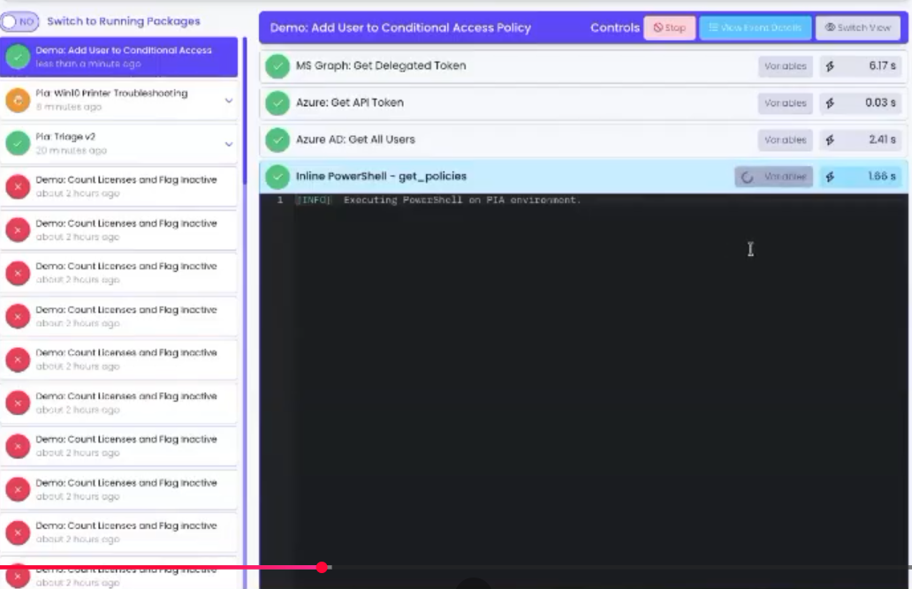
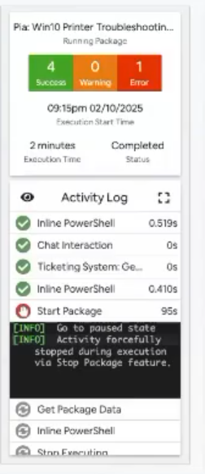
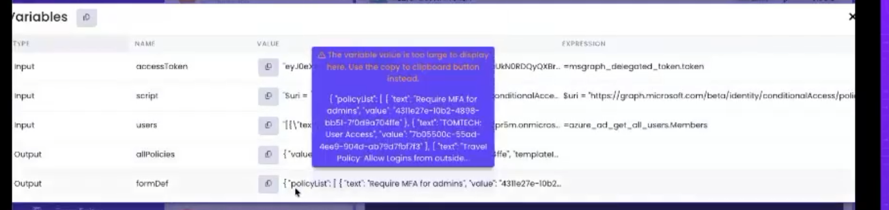

# WebSocket Activity Monitor — Design

**Date:** 2026-09-09
**Status:** Approved for planning

## Motivation

`IoTPowerShellAgent` executes PowerShell scripts submitted via Azure IoT Hub direct
methods and reports structured results back through IoT Hub telemetry. There is
currently no way to *watch* execution happen in real time — the only visibility is
after-the-fact (IoT Hub telemetry, Windows Event Log). This feature adds a local,
real-time activity monitor: a WebSocket endpoint that streams PowerShell execution
output as it happens, plus a small self-contained webpage that renders it as a
live activity monitor.

Phase 1 scope: a single agent-hosted page, opt-in, loopback-only by default.

## Reference UI

The visual/interaction target is a Rewst-style workflow activity monitor:

-  —
  sidebar of past/live runs (status dot, title, relative time) + detail pane for the
  selected run (header, per-step activity list with duration badges, live black
  terminal tail of the currently running step).
-  — compact
  summary card: Success/Warning/Error counts, start time, elapsed/duration, status,
  collapsible activity log, black `[INFO]`-style terminal box.
-  —
  a popover listing Input/Output variables for a step, with copy-to-clipboard for
  values too large to display inline.

### Fidelity note

Rewst's workflow has distinct named **sub-steps**, each with its own captured
variables. `IoTPowerShellAgent` only sees **one flat PowerShell stream per
execution** (Output/Error/Warning/Verbose/Debug/Information/Progress lines) — there
is no sub-step graph to inspect. Consequently:

- The "activity log" for a run is a flat, chronological list of stream events
  (icon + elapsed-time badge), not nested workflow steps.
- The "Variables" drill-down operates at the **execution** level: Input is the
  script source, Output is the final serialized result / error message — not
  per-line or per-command variables.

This is the honest ceiling of what the current execution model exposes without a
much larger investment in per-command introspection, which is out of scope here.

## Non-goals (phase 1)

- Remote/LAN viewing without authentication (default bind is loopback-only).
- New script submission from the monitor page (the only write action is
  cancelling an already-running execution — see [Security model](#security-model-for-the-cancel-action)).
- Persistent execution history across agent restarts (in-memory only).
- Per-command/per-line variable capture.
- Hosting the monitor in `--debug`/`--test` console modes (they bypass
  `IoTHubService` entirely and are unaffected by this feature).

## Architecture

```
IoTHubService.ExecuteScriptMethodHandler
        │
        ├─ MonitorHub.Instance.NotifyExecutionStarted(id, preview, script)
        ├─ MonitorHub.Instance.RegisterCancellation(id, cts)
        ├─ new PowerShellExecutor(MonitorHub.Instance.Wrap(_logCallback, id))
        │        │
        │        └─ SendLog(...) → wrapped callback → inner (EventLogCallback, unchanged)
        │                                            → MonitorHub (buffer + broadcast)
        └─ finally: MonitorHub.Instance.NotifyExecutionCompleted(id, ...)

MonitorHub (singleton)                     MonitorServer (HttpListener)
  - execution history (bounded)              - serves monitor.html at "/"
  - per-execution log buffers (bounded)       - upgrades "/ws" to WebSocket,
  - connected WebSocket clients                 registers/unregisters with MonitorHub
  - CancellationTokenSource registry          - per-client receive loop → forwards
                                                 {"type":"cancel", executionId} to
                                                 MonitorHub.RequestCancel
```

`MonitorServer` is started/stopped from `PowerShellExecutorService.OnStart`/`OnStop`,
the same composition root that already creates `EventLogCallback`. It is only
created when `EnableMonitorServer` is true in settings. `--debug`/`--test` modes use
`LocalIoTTester`, which never touches `IoTHubService`, so they are unaffected by
construction — no extra guarding needed there.

`System.Net.HttpListener` is used instead of ASP.NET Core/Kestrel: it's built into
.NET (zero new dependencies), supports WebSockets natively via
`HttpListenerContext.AcceptWebSocketAsync()`, and matches this project's existing
philosophy of a lightweight native host rather than a web framework. Binding to a
literal loopback IP (`127.0.0.1`, not a wildcard) also avoids the Windows URL-ACL
reservation that wildcard/non-loopback `HttpListener` bindings require, so this
works even if the service is later reconfigured to run under a lower-privileged
account per the README's least-privilege guidance.

## Components

### `MonitorHub` (new, `Monitoring/MonitorHub.cs`)

Singleton (`MonitorHub.Instance`), matching the existing `SettingsService.Instance`
convention. Responsibilities:

- **History**: bounded collection of `ExecutionRecord`s — id, script preview
  (first line / ~80 chars), full script text, start time, status
  (`Running`/`Success`/`Warning`/`Error`/`Cancelled`), completion time, final
  output/error message, and a capped ring buffer of log lines (~500 lines per
  execution). Retains the last ~20 completed executions plus all currently-running
  ones; oldest completed entries are evicted first. This is a live monitor, not an
  audit log — durable history already exists via IoT Hub telemetry / Windows Event
  Log.
- **`Wrap(ILogCallback? inner, string executionId)`** → returns a decorator that
  forwards every log line to `inner` unchanged (so existing behavior — Windows
  Event Log, IoT Hub telemetry — is untouched) and additionally appends it to that
  execution's buffer and broadcasts it to connected clients.
- **`NotifyExecutionStarted(id, scriptPreview, fullScript)`** — creates the record,
  broadcasts an `execStart` envelope.
- **`NotifyExecutionCompleted(id, success, output, errorMessage, wasCancelled)`** —
  finalizes the record (duration computed from the record's own start time),
  broadcasts an `execEnd` envelope, unregisters any cancellation entry for `id`.
  Must be called exactly once per `NotifyExecutionStarted` — enforced at the call
  site via `try/finally` (see below), not by `MonitorHub` itself.
- **`RegisterCancellation(id, CancellationTokenSource cts)`** /
  **`RequestCancel(id)`** — looks up the CTS for `id` and calls `.Cancel()` if
  present and not already triggered. This is the *only* write path exposed to the
  page.
- **`RegisterClient`/`UnregisterClient`/`BroadcastAsync`** — client bookkeeping.
  Broadcast failures (dead/slow sockets) prune that client rather than blocking
  others.
- **`GetSnapshot()`** — full history + records, sent to a client immediately after
  it connects, so a freshly opened tab isn't blank and shows in-flight executions
  as already running.
- All of the above are cheap no-ops when the feature is disabled (`Enabled` gate
  checked internally), so `IoTHubService` doesn't need conditional logic at the
  call site — it always calls through; `MonitorHub` decides whether there's
  anything to do.

### `MonitorServer` (new, `Monitoring/MonitorServer.cs`)

Thin `HttpListener` wrapper:

- `Start()` / `Stop()` lifecycle, called from `PowerShellExecutorService`.
- `GET /` → serves `monitor.html` (read from disk once at start, cached in memory;
  the file is copied to the output directory the same way `appsettings.json` is
  linked in the csproj today).
- `GET /ws` → `AcceptWebSocketAsync`, registers the socket with `MonitorHub`, then
  runs two loops per connection: a receive loop (parses incoming JSON, currently
  only the `cancel` command, forwards to `MonitorHub.RequestCancel`) and relies on
  `MonitorHub.BroadcastAsync` for outbound pushes.
- Start failures (port in use, etc.) are logged as a non-fatal warning through the
  existing `EventLogCallback` — the service continues running without the
  monitor, mirroring `AutoUpdater`'s non-fatal failure handling.

### `monitor.html` (new static asset)

Single self-contained file — no CDN dependencies (the host may have no outbound
internet, and this keeps the loopback trust boundary simple). Black background,
monospace terminal styling. Layout:

- **Summary strip**: aggregate Success/Warning/Error counts across retained
  history (mini-widget style).
- **Sidebar**: list of executions — status dot/spinner, script preview, relative
  time ("less than a minute ago", "8 minutes ago", computed client-side from the
  record's start time).
- **Detail pane** for the selected execution:
  - Header: title (script preview), elapsed/duration timer (ticks live while
    running), status, a **Stop** button enabled only while `Running` — sends
    `{"type":"cancel","executionId":...}` over the open WebSocket.
  - Flat activity-log list: one row per buffered stream event, icon by stream
    type (Output/Information ✓, Warning ⚠, Error ✕, Verbose/Debug/Progress
    muted), elapsed-time badge.
  - Live black terminal tail rendering the same events as raw `[LEVEL] message`
    lines, auto-scrolling.
  - **Variables** button/pill → popover with Input (script, copy-to-clipboard,
    truncated display past ~2000 chars with a "too large to display, use copy"
    note) and, once completed, Output/ErrorMessage rendered the same way.
- WebSocket client reconnects with backoff on drop; on (re)connect, requests and
  renders the `GetSnapshot()` payload before processing live events.

## Protocol

JSON envelopes over the WebSocket, serialized with `System.Text.Json` (already
used in `IoTHubService`):

Server → client:
```jsonc
{ "type": "snapshot", "executions": [ /* ExecutionRecord summaries incl. buffered lines */ ] }
{ "type": "execStart", "executionId": "...", "timestamp": "...", "scriptPreview": "...", "script": "..." }
{ "type": "log", "executionId": "...", "timestamp": "...", "stream": "Error|Warning|Information|Verbose|Debug|Progress", "message": "..." }
{ "type": "execEnd", "executionId": "...", "timestamp": "...", "success": true, "wasCancelled": false, "durationMs": 1234, "output": "...", "errorMessage": "" }
```

Client → server:
```jsonc
{ "type": "cancel", "executionId": "..." }
```

Output/error/script fields are sent in full (loopback traffic, no bandwidth
concern) but capped at a sane size (e.g. 200 KB) server-side to guard against a
pathological script producing huge output; the page additionally truncates the
*displayed* text and offers copy-to-clipboard for the full value, matching the
reference screenshots' "too large to display" treatment.

## Wiring into `IoTHubService`

Both execution paths in `ExecuteScriptMethodHandler` (the synchronous path and the
detached/background path) currently do `new PowerShellExecutor(_logCallback)`.
Both become:

```csharp
string executionId = Guid.NewGuid().ToString("N").Substring(0, 8);
MonitorHub.Instance.NotifyExecutionStarted(executionId, scriptPreview, script);
MonitorHub.Instance.RegisterCancellation(executionId, cts);
try
{
    var executor = new PowerShellExecutor(MonitorHub.Instance.Wrap(_logCallback, executionId));
    var result = await executor.ExecutePowerShellAsync(script, request.IsInlinePowershell, cts.Token).ConfigureAwait(false);
    // ... existing response building ...
}
finally
{
    MonitorHub.Instance.NotifyExecutionCompleted(executionId, /* success */, /* output */, /* errorMessage */, /* wasCancelled */);
}
```

The exact shape of capturing `success`/`output`/`errorMessage`/`wasCancelled` for
the `finally` block (given the method currently returns early from three separate
branches: success, `OperationCanceledException`, generic `Exception`) is an
implementation detail for the plan — the contract is: **exactly one
`NotifyExecutionCompleted` call per `NotifyExecutionStarted`, regardless of which
branch is taken.**

No changes are needed to `ILogCallback`, `EventLogCallback`, existing tests/mocks,
or `LocalIoTTester`.

## Settings (added to `ServiceSettings`)

```csharp
public bool EnableMonitorServer { get; set; } = false;       // opt-in
public string MonitorServerBindAddress { get; set; } = "127.0.0.1"; // loopback default
public int MonitorServerPort { get; set; } = 5757;
```

## Security model for the Cancel action

The monitor's only write capability is cancelling an already-running execution,
implemented by calling `.Cancel()` on the same `CancellationTokenSource` already
used for `ScriptTimeoutSeconds` — i.e. it triggers the *existing* timeout
cancellation path early, not a new mechanism. This does not grant new privileged
capability: it cannot submit new scripts, and anyone able to reach the loopback
interface on the host already has more direct means of privileged access than
stopping an in-flight script the agent itself launched.

**Hard requirement for any future LAN mode**: if `MonitorServerBindAddress` is ever
configured to a non-loopback address, both viewing *and* the Cancel action must be
gated behind authentication before that ships. Phase 1 does not implement this
because the default (and only supported) bind is loopback.

## Error handling

- `MonitorServer` start failure → non-fatal warning via `EventLogCallback`;
  service continues without the monitor.
- Dead/slow WebSocket clients are pruned on send failure/timeout; one
  unresponsive client cannot block broadcasting to others.
- A `cancel` message referencing an unknown/already-completed `executionId` is a
  silent no-op.

## Testing

- Unit tests in `IoTPowerShellAgent.Tests` (existing Moq/xUnit style) for
  `MonitorHub`: ring-buffer eviction, `Wrap` forwarding to `inner`, snapshot
  shape, `RequestCancel` behavior (found/not-found), no-op behavior when disabled.
- Manual end-to-end verification during implementation: a throwaway
  `ClientWebSocket` test harness driving a real `ExecuteScriptMethodHandler` call
  (rather than requiring a live IoT Hub connection) to confirm `execStart`/`log`/
  `execEnd`/cancel messages arrive as expected.

## Follow-ups (explicitly out of scope now)

- Authenticated LAN-accessible mode.
- Persistent history across restarts.
- Per-command variable capture (would require much deeper PowerShell runspace
  introspection).
